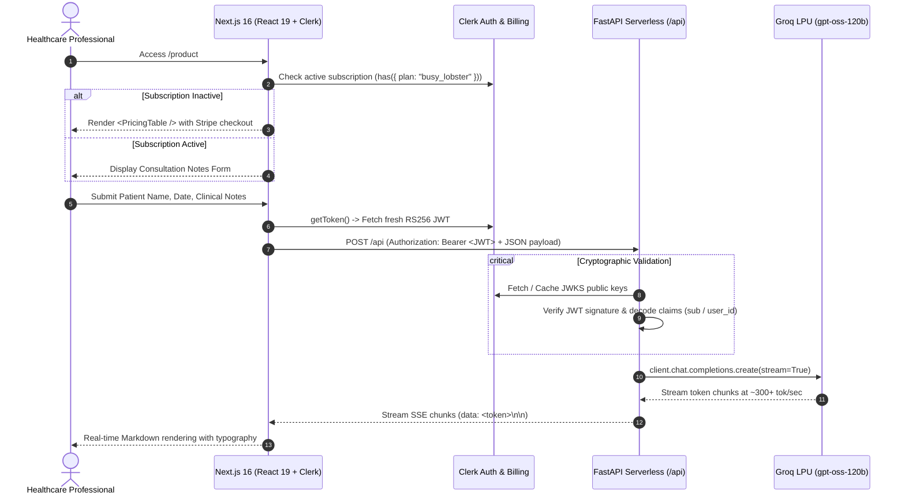

# 🩺 MediNotes Pro — Medical Report & Patient Mail Generator

[](https://nextjs.org/)
[](https://react.dev/)
[](https://fastapi.tiangolo.com/)
[](https://python.org/)
[](https://clerk.com/)
[](https://groq.com/)
[](https://vercel.com/)
[](https://www.typescriptlang.org/)

An enterprise-ready, full-stack AI SaaS application engineered for healthcare professionals. **MediNotes Pro** transforms raw, unstructured clinical consultation notes into formatted medical records, actionable clinical next steps, and empathetic, patient-friendly follow-up emails in real time.

Built with a high-performance polyglot architecture combining a **Next.js 16 (React 19)** frontend with a **FastAPI** Python backend, featuring **JWKS cryptographic authentication**, **token-by-token Server-Sent Events (SSE) streaming**, and **Clerk Core 3 subscription gating**.

---

## 🌟 Core Highlights & Architectural Strengths

In today's AI engineering and full-stack landscape, production-grade applications require far more than basic API wrappers. This project demonstrates battle-tested software engineering practices:

- **⚡ Sub-Second Token Streaming via SSE**: Replaces slow, buffered HTTP requests with real-time Server-Sent Events (`fetchEventSource` + FastAPI `StreamingResponse`), delivering an ultra-responsive interface with live Markdown rendering as tokens stream from Groq's LPUs.
- **🔐 End-to-End Cryptographic JWT Auth**: The FastAPI microservice does not rely on opaque headers; it cryptographically validates incoming Clerk session JWTs directly against Clerk's remote JSON Web Key Set (`JWKS`) endpoint on every request.
- **💳 Modern Subscription Entitlements (Clerk Core 3)**: Implements cutting-edge declarative authorization using Clerk Core 3's `<Show when={(has) => ...}>` primitives, seamlessly synchronizing frontend UI protection with active Stripe/Clerk billing tiers.
- **🧠 Domain-Specific Clinical Prompt Engineering**: Translates complex, medical shorthand into structured tripartite outputs:
  1. **Physician Record Summary**: Formal, objective clinical documentation.
  2. **Action Items**: Explicit diagnostic, medication, and referral checklists.
  3. **Patient-Friendly Communication**: Accessible, compassionate discharge instructions in plain language.
- **☁️ Polyglot Vercel Serverless Architecture**: Next.js client and FastAPI Python serverless functions co-exist in a unified monorepo with automated routing, zero configuration drift, and CI/CD deployment parity.

---

## 🏗️ Architecture & Data Flow



---

## 🛠️ Technology Stack

| Layer | Technology | Engineering Rationale |
|---|---|---|
| **Frontend Framework** | [Next.js 16.4](https://nextjs.org/) | Turbo-powered build performance, optimized static prerendering, and modern routing. |
| **UI Library** | [React 19](https://react.dev/) | Leverages the latest React concurrent features and component lifecycle optimizations. |
| **Type Safety** | [TypeScript 5](https://www.typescriptlang.org/) | Strict typing across UI components, event handlers, and data payloads. |
| **Styling** | [Tailwind CSS v4](https://tailwindcss.com/) + Typography | Modern CSS engine with `@tailwindcss/typography` for clinical document styling. |
| **Auth & Billing** | [Clerk Core 3](https://clerk.com/) | Unified user management, session token generation, and plan entitlement enforcement. |
| **Backend API** | [FastAPI](https://fastapi.tiangolo.com/) + Pydantic | Asynchronous Python framework with strict request payload validation schemas. |
| **Auth Middleware** | `fastapi-clerk-auth` | Cryptographic JWT verification via Clerk JWKS public keys. |
| **Inference Engine** | [Groq Cloud](https://groq.com/) | Hardware-accelerated LPU inference utilizing `openai/gpt-oss-120b` for minimal latency. |
| **Real-Time Streaming** | `@microsoft/fetch-event-source` | Resilient SSE connection handling with custom headers and abort signal controls. |
| **Hosting & CI/CD** | [Vercel](https://vercel.com/) | Serverless deployment combining Next.js edge assets with Python serverless functions. |

---

## 📁 Repository Structure

```text
├── api/
│   └── index.py             # FastAPI serverless backend (Pydantic validation, JWKS guard, Groq stream)
├── pages/
│   ├── _app.tsx             # Global application wrapper with ClerkProvider & styles
│   ├── _document.tsx        # HTML document shell with accessibility & metadata
│   ├── index.tsx            # Marketing landing page with features grid and auth controls
│   └── product.tsx          # Protected consultation suite with plan entitlement checks
├── public/                  # Favicons and static web assets
├── styles/
│   └── globals.css          # Tailwind CSS v4 styling rules
├── .env.example             # Documented template for required environment variables
├── .gitignore               # Strict ignore rules preventing credential leaks
├── next.config.ts           # Next.js and Turbopack compiler configuration
├── package.json             # Frontend dependencies and deployment scripts
├── requirements.txt         # Python dependencies for the FastAPI runtime
└── tsconfig.json            # Strict TypeScript configuration
```

---

## 🔒 Security & Compliance Considerations

- **Zero Credential Exposure**: Client-side code strictly consumes public keys (`NEXT_PUBLIC_CLERK_PUBLISHABLE_KEY`). All backend secrets (`CLERK_SECRET_KEY`, `GROQ_API_KEY`, `CLERK_JWKS_URL`) remain isolated inside server-side environments.
- **Cryptographic Token Verification**: In order to prevent spoofed user IDs, the backend authenticates every request using public keys published by Clerk's JWKS (`.well-known/jwks.json`).
- **Pydantic Validation**: All incoming requests to `/api` are parsed and validated through the `Visit` Pydantic model, rejecting malformed payloads before invoking downstream inference.
- **Request Cancellation**: Frontend employs `AbortController` alongside `@microsoft/fetch-event-source` to gracefully close active streams if the user navigates away or cancels, avoiding runaway LLM inference costs.

---

## 🚀 Getting Started

### Prerequisites

Ensure you have the following installed locally:
- **Node.js** 20.x or higher
- **npm** or **pnpm**
- **Python** 3.10 or higher
- **Vercel CLI** (`npm i -g vercel`)

### 1. Clone & Install Dependencies

```bash
git clone https://github.com/awasthypranshu/Medical-Report-Mail-Generator.git
cd Medical-Report-Mail-Generator

# Install frontend dependencies
npm install

# (Optional) Set up Python virtual environment for local backend testing
python -m venv venv
# On Windows:
.\venv\Scripts\activate
# On macOS/Linux:
source venv/bin/activate

pip install -r requirements.txt
```

### 2. Configure Environment Variables

Create a `.env.local` file in the root directory:

```bash
cp .env.example .env.local
```

Fill in your respective API keys:

```env
# Groq API Key (Obtain from https://console.groq.com/keys)
GROQ_API_KEY=gsk_...

# Clerk Auth Keys (Obtain from https://dashboard.clerk.com)
NEXT_PUBLIC_CLERK_PUBLISHABLE_KEY=pk_test_...
CLERK_SECRET_KEY=sk_test_...
CLERK_JWKS_URL=https://<your-subdomain>.clerk.accounts.dev/.well-known/jwks.json
```

### 3. Run Locally

```bash
# Start Next.js development server
npm run dev
```

Visit `http://localhost:3000` in your browser.

---

## ☁️ Deployment (Vercel)

The repository is pre-configured for Vercel's hybrid Next.js + Python serverless execution:

1. Link your project to Vercel:
   ```bash
   vercel
   ```
2. Set your environment variables in the Vercel dashboard or CLI:
   ```bash
   vercel env add NEXT_PUBLIC_CLERK_PUBLISHABLE_KEY
   vercel env add CLERK_SECRET_KEY
   vercel env add CLERK_JWKS_URL
   vercel env add GROQ_API_KEY
   ```
3. Deploy to production:
   ```bash
   vercel --prod
   ```

---

## 👨‍💻 Developer & Contact

**Pranshu Awasthy**  
- **GitHub**: [@awasthypranshu](https://github.com/awasthypranshu)
- **Project Repository**: [Medical-Report-Mail-Generator](https://github.com/awasthypranshu/Medical-Report-Mail-Generator)

---

## 📄 License

This project is licensed under the MIT License — see the [LICENSE](LICENSE) file for details.
